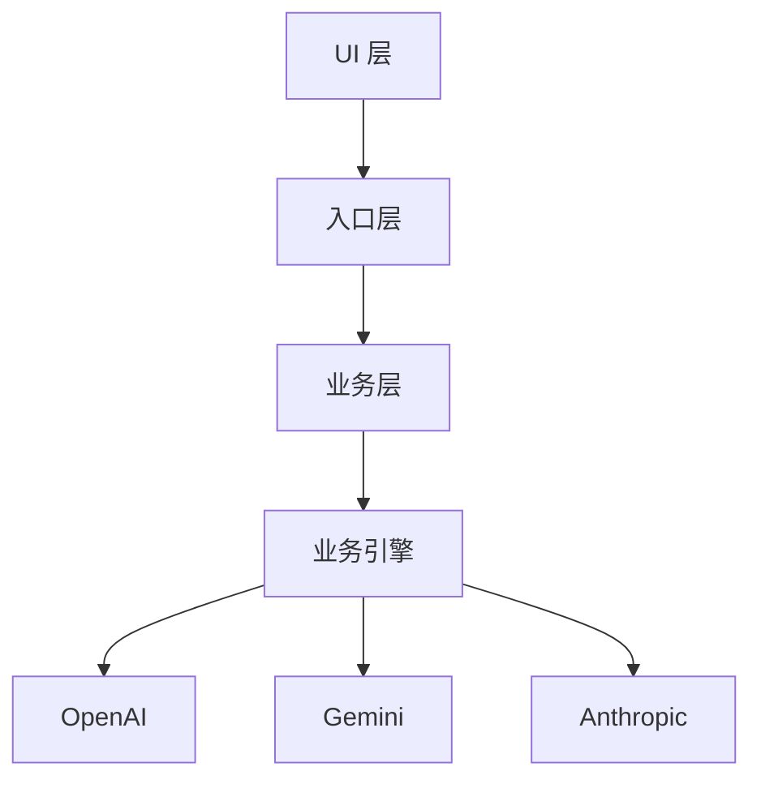

# 写给人看的文档

把文档当作独立交付物，而不是聊天记录、调查笔记或源码导读。读者即使不知道讨论过程、不读代码，也应能理解正文。

## 一、先讲业务，让读者不用读代码

写作前先想清楚：读者要理解什么？围绕业务、概念、流程和设计思想组织内容，不按源码文件、函数调用或调查顺序铺开。

- 用常用中文讲清事情是什么、为什么这样设计、各部分有什么关系。
- 举例、类比和表格用于帮助理解，不用来堆砌信息。
- 源码阅读是调查手段，不是正文结构。通常不写源码路径、行号、函数名、字段名和调用链。
- 专业英文单词只在有明确表达意义时保留，并尽量用中文说明。例如 `Host`、`Client` 是架构概念，可以写成“宿主端（Host）”；但不要因为有英文术语就顺带介绍其代码实现。
- **代码变量名绝不能出现在正文。** 功能、配置和工具都用中文名称或自然语言称呼，不写 `expandSlashCommand`、`GARDENER_TASK_PROMPT` 这类标识符，也不以反引号包装来规避。
- 用户明确要求源码导读、接口参考、配置字段说明或代码示例时，才按该用途提供必要的代码内容。除此之外，“技术文档”不等于“源码文档”。

**判断标准：把代码细节全部拿掉后，核心业务解释仍然完整；读者不必打开源码才能看懂。**

## 二、不留编辑痕迹，但保留该写的修改记录

先区分两件事：**文档编辑过程**和**文档需要记录的修改内容**。这里禁止的是前者，绝不能因此漏写后者。

### 普通正文：只呈现当前内容

文档正文只写当前成立的内容。改了就是改了，不把“这次怎么改、以前怎么写”混进普通正文。

普通正文中不得出现：

- “先纠正一个容易产生的误解”“原来的说法不准确”；
- “本次新增”“本次删除”“现已改为”“不再采用旧版”；
- “根据用户要求”“经过讨论决定调整文档”；
- “本文不涉及某内容”这类为了交代本次删改范围而写的声明；
- 用来解释本次编辑的修改对照表、修订说明或编辑自言自语。

需要解释一个常见误解时，先判断它是否对读者理解主题确有必要。没有必要就直接陈述正确事实，不安排“纠正读者”的开场。

### 修改记录：按要求正常写，不能省略

如果文档本身就是修改记录、决策记录、版本历史，或者设有“修改记录”“变更历史”“本次调整”等独立章节，这些记录就是文档的正式内容。用户要求保留、追加或增量展示时，必须如实写清，不能以“只写最终内容”为由删除、跳过或改写成当前状态概述。

- 独立修改记录章节仍按原有格式增量追加，旧记录不被新记录覆盖。
- 产品、功能、方案等业务内容的变化，该记录就记录；这与文档编辑痕迹不是一回事。
- 只有没有专门用途时，才清理散落在普通正文中的编辑说明；不得把明确要求的记录章节当成编辑痕迹。
- 拿不准某段是必要记录还是编辑残留时，保留该段并向用户确认，不擅自删除。

**判断标准：第一次阅读普通正文时，不必了解文档的编辑过程；需要查阅修改记录时，又能找到完整、连续的真实记录。**

## 三、注意全文一致性

修改后留意相关段落、标题、摘要和结论是否仍然一致。发现前文与后文冲突时，以核实后的内容为准统一修正，不在正文解释冲突的来龙去脉。

事实、推断和尚未确认的内容要分清；不把尚未核实的猜想写成确定结论。

## 四、守住本次文档任务

只写用户需要的内容。解释概念、调查实现和提出方案是不同任务，不因为调查时想到了方案，就自行把方案建议、后续计划或其他项目的设计塞进文档。

新增一节、改变文档用途或扩大讨论范围前，先看它是否服务于当前主题；无关内容即使已经调查过，也不写入。

## 五、成稿前快速检查

- **能读懂**：不看代码、不了解讨论背景，也能理解主要内容。
- **像中文**：没有不必要的英文和代码腔，普通正文没有代码变量名。
- **是该有的定稿**：普通正文没有编辑痕迹和对话残留；明确要求的修改记录、变更历史没有缺失，旧记录也没有被覆盖。
- **没跑偏**：内容服务于当前文档主题，没有自行扩展任务。
- **能自洽**：重要结论与后文、表格、摘要不矛盾。

---

# 结构化内容与图形的表达规范

创建或编辑文档时，优先保证语义清晰、结构明确和跨环境渲染稳定，不要使用纯文本字符模拟复杂的视觉布局。

## 适用范围

本规范适用于 Markdown 文档（README、设计文档、技术方案、Wiki 等）。

以下场景**不适用**，其中的字符图形是合理表达，不要"修正"它们：

- 源代码中的注释（包括 ASCII 架构图）
- Git commit message、纯文本邮件、CLI 帮助文本等无渲染环境的纯文本
- `.txt` 等明确以纯文本形式分发的文档

## 核心禁令

不要使用纯文本字符来模拟架构图、流程图、依赖关系图、状态机、方框、树状图、二维布局、表格，或其他依赖字符位置表达空间关系的图形。

具体禁止：

- 使用大量空格进行对齐
- 使用重复的 `-`、`_`、`=`、`|` 制作图形
- 使用 Unicode 方框字符，例如 `┌ ┐ └ ┘ ├ ┤ │ ─`
- 使用换行加箭头字符制作流程图，例如：

      A
      ↓
      B
      ↓
      C

- 依靠缩进位置表达二维结构
- 手工控制字符间距来模拟节点、连线或多列布局

原因是这种表达依赖字体、空白字符宽度、编辑器宽度、换行规则和渲染环境。换一个客户端、字体或屏幕尺寸后，很容易错位并失去可读性。

**注意区分**：单行内联的短箭头链不依赖二维空间位置，是合法的，例如"编译 → 链接 → 运行"。禁令针对的是跨多行、靠纵向对齐构成的字符图。

## 表达方式选择

默认按以下优先级选择表达方式：

1. 具有正式语法和解析器的图表 DSL
2. Markdown Table
3. Markdown 标题与列表
4. 代码块 / 配置格式
5. 普通文字
6. ASCII / Unicode 伪图（仅在用户明确要求时）

具体场景的推荐：

- **简单线性流程**（无分支、无回路）：首选编号列表，不要为了"像图"而使用 Mermaid。例如上面"禁止"示例中的 A → B → C，正确写法就是三个列表项。
- **有分支、回路、泳道或多方交互的流程**：使用 Mermaid。
- **时序交互**：使用 Mermaid sequence diagram。
- **ER 关系**：使用 Mermaid ER diagram 或其他成熟的图表 DSL。
- **复杂 UML**：根据需要使用 PlantUML。
- **二维数据**：使用 Markdown Table。
- **层级信息**：使用 Markdown 标题和列表。
- **配置与结构化数据**：使用 YAML、JSON、TOML 或 Markdown Table。
- **数学公式**：在支持的环境中使用 LaTeX/MathJax。
- **无法用文本 DSL 清晰表达的复杂视觉内容**：使用真正的图片，而不是用字符模拟。

## 判断规则

在准备输出类似"图"的内容之前，先判断：

> **这个内容的含义是否依赖字符在二维空间中的位置？**

如果答案是"是"：

1. 优先使用 Mermaid 或其他合适的图表 DSL。
2. 如果没有合适的 DSL，或结构简单到不值得画图，使用结构化列表、表格或普通文字。
3. 只有用户明确要求 ASCII 图、字符画或纯文本图时，才使用纯文本绘图。

如果某个关系重要到需要用图来表达，就应该使用真正的图表语法。

## Mermaid 使用规范

使用 Mermaid 时：

- 描述节点和关系，而不是手工描述节点应该摆在哪里。
- 让 Mermaid 的渲染器负责布局、间距和连线。
- 节点文字保持简洁；**节点文本含括号、冒号或其他特殊字符时，必须用引号包裹**，否则整张图渲染失败。
- 使用 `subgraph` 表达有意义的架构边界。
- 根据内容选择合适的方向，例如 `TB`、`LR`。
- 复杂内容优先拆成多个小图，而不是制作一个密集的大图。
- 不要使用空格、不可见字符或手工换行来控制图形位置。
- 不要为了"看起来像图"而手工排列文本。

渲染失败的 Mermaid 比列表糟糕十倍。生成后自查一遍语法是否成立。

例如：

## 特别注意 Markdown 表格

对于真正的二维数据表格，使用 Markdown Table。

不要使用空格手工制作表格，例如：

    Name       Type       Status
    User       Entity     Active
    Product    Entity     Draft

应该写成：

| Name | Type | Status |
|---|---|---|
| User | Entity | Active |
| Product | Entity | Draft |

## 特别注意代码块

代码块用于：

- 源代码
- Shell 命令
- 配置文件
- JSON / YAML / TOML
- Mermaid / PlantUML 等 DSL
- 命令的真实输出捕获
- 其他本身具有明确语法的文本格式

不要仅仅因为"代码块可以保持等宽字体"，就把普通信息塞进代码块里进行手工排版。

**例外**：`kubectl get pods`、`df -h` 等命令的真实输出本身就是空格对齐的。原样粘贴到代码块中是逐字记录，属于保真而非手工排版，不要把它"优化"成 Markdown 表格——那会丢失真实性。

## 编辑存量文档

编辑既有文档时，替换伪图的工作遵循本次任务的范围：只重绘与本次改动直接相关的内容，不顺手把文档中其他遗留的字符画全部重写。大规模的存量伪图清理应作为独立任务进行，避免无关改动混入当前变更。

## 最终检查

完成文档前，检查：

- 是否出现了意外的 Unicode 伪图（方框字符、多行箭头流程图、空格对齐的伪表格）？
- 这些内容能否替换成 Mermaid、Markdown Table、列表或普通文字？
- 简单线性流程是否被不必要地画成了 Mermaid？
- Mermaid 节点文本中的特殊字符是否加了引号，语法能否正常渲染？
- 代码块中的内容是否属于"真实输出捕获"而被误改？

如果发现应改未改的情况，主动替换。

## 最终目标

目标不是让文档变得朴素或缺乏视觉结构。

目标是：

> **凡是具有结构意义的内容，都应该用能够表达这种结构的正式格式来描述，而不是依赖字符的位置来"画出来"。**

纯文本应该描述内容。

Markdown 应该描述文档结构。

Mermaid / PlantUML 等 DSL 应该描述图形结构。

真正的图片应该承担复杂的视觉表达。

不要让空格、字体宽度和 Unicode 字符承担图形布局的职责。
